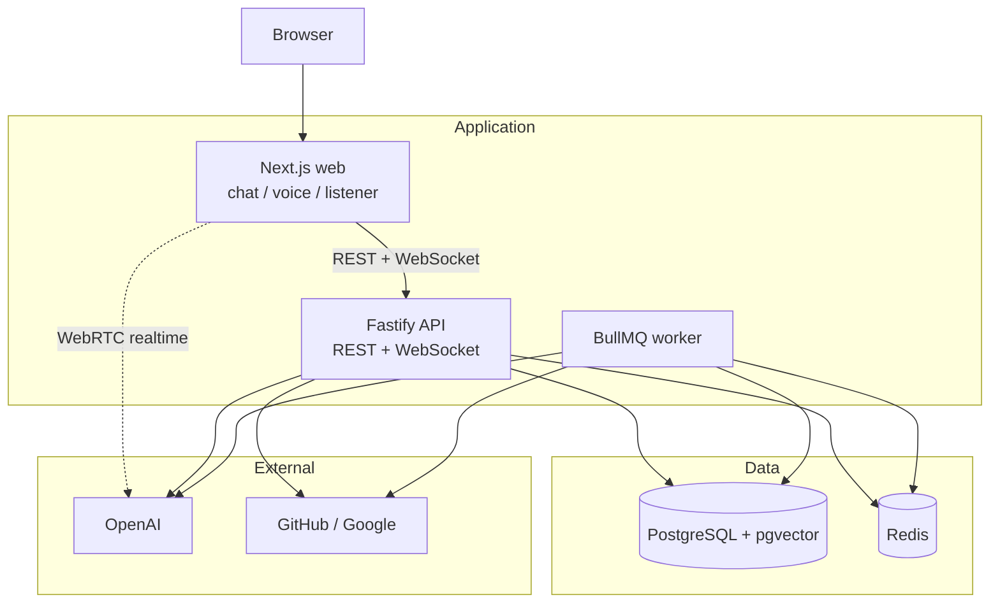
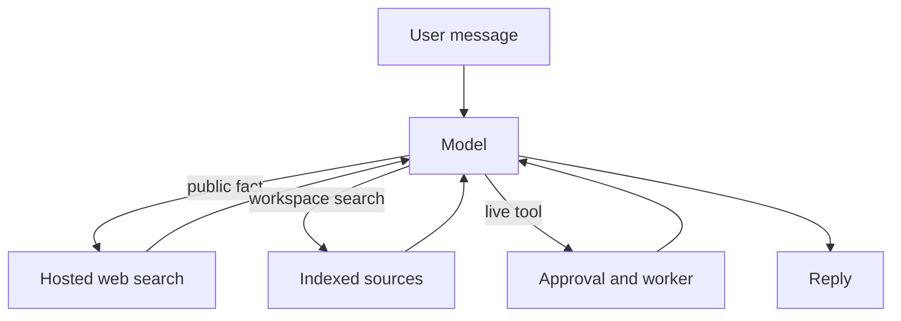

# Agentic AI Assistant

Agentic AI Assistant (AAA) is a personal assistant you run yourself. You can chat with it or talk to it. It remembers you, looks through your notes and connected accounts, and can take actions you approve.

With most AI chats, your conversations, memories, and files live on the company's site. Here, they stay with you. The model only sees what it needs to answer, and when a better model comes along you can switch to it without losing your history.

## Features

- Chat interface with persistent conversation history
- Voice mode with live transcription and spoken responses
- Answers drawn from your notes, files, and connected accounts
- Persistent personalization, preferences, and long-term memory
- Asks for approval before it changes something, such as a document or a repository

### How it answers

When you send a message, the assistant answers. If it needs something the conversation does not already have, it can look it up:

- **The web** — A current public fact
- **Your files** — Notes, attachments, and files from connected accounts
- **Connected apps** — GitHub, Google, and other tools. Changes wait for your approval

### Live Voice

Live voice makes the assistant feel more natural to work with by letting users talk through ideas, ask follow-up questions, and keep a conversational flow without leaving the chat experience.

### Personalization

Personalization settings control both assistant behavior and long-term memory. Communication preferences, such as tone and writing style, and durable memories, such as facts, relationships, and important people, are saved with the assistant and carry from one conversation to the next.

### Connected Apps

Provider apps connect once per external provider and expose separate internal capabilities:

- **Knowledge** — Used for sync, indexing, and retrieval, such as using docs or repository context for RAG
- **Tools** — Used for live tool access and side-effectful operations, such as editing docs in Google Drive or making code changes in a GitHub repository

## Architecture

### System Architecture

AAA keeps conversations, memory, connected apps, and tool workflows in user-owned storage, and treats the chat model as a swappable backend. The Next.js web app talks to a Fastify API over REST and WebSocket. Voice and Listener Mode mint OpenAI Realtime sessions on the API, then stream audio over WebRTC. A BullMQ worker handles ingestion, embeddings, app sync, and tool execution. PostgreSQL with pgvector stores app data, attachments, memory, and embeddings; Redis backs the job queues.



Text chat streams tokens and tool events over WebSocket. When the model calls a live tool, the API records it, requests approval if needed, and enqueues execution on the worker. After a non-voice tool finishes, a chat-continuation job returns to the API so the model can continue the turn. Workspace search runs in the API during the turn. Connected apps split into knowledge (sync, index, retrieve) and tools (live reads and writes against GitHub and Google).

Shared packages own the seams between apps: the model gateway, retrieval, tools, knowledge-source sync, memory, database access, and queues. Chat models can be swapped without changing those layers. Voice and Listener Mode use a realtime path and do not go through the chat-provider gateway.

Production runs the web, API, worker, and data services on a single host behind a reverse proxy. See the infrastructure docs for deploy details.

### Chat turn

A text message can search the public web, search the user's own files, or call a live tool. The model decides which. A search of the user's files runs in the API, and the model continues in the same turn. Writes still wait for approval, then run on the worker, and a later turn continues from the tool result.



## Local Development Setup

### Prerequisites

- **Node.js** >= 20
- **pnpm** >= 9
- **Docker** and **Docker Compose** (for local services)
- **Model provider API key**
- **WSL or Git Bash on Windows** recommended for local app startup

### Clone The Repository

```bash
git clone https://github.com/your-org/agentic-ai-assistant.git
cd agentic-ai-assistant
```

### Configure The Environment

```bash
cp .env.example .env
# Edit .env and add your real values
```

See `.env.example` for the full template.

### Install Dependencies

```bash
pnpm install
```

### Start The App

```bash
pnpm dev:local
```

That command handles the local startup flow for you.

### Verify It’s Working

- Open `http://localhost:3000`
- Check API health at `http://localhost:3001/health`
- Use development login from the home page when `NODE_ENV` is not `production`

### Local Observability

`pnpm dev:local` also starts the local observability stack with Grafana, Prometheus, Loki, and Tempo. App, API, worker, metrics, and dashboard endpoints are exposed locally for debugging and development.

## License

This project is licensed under the [GNU General Public License v3.0](LICENSE).
