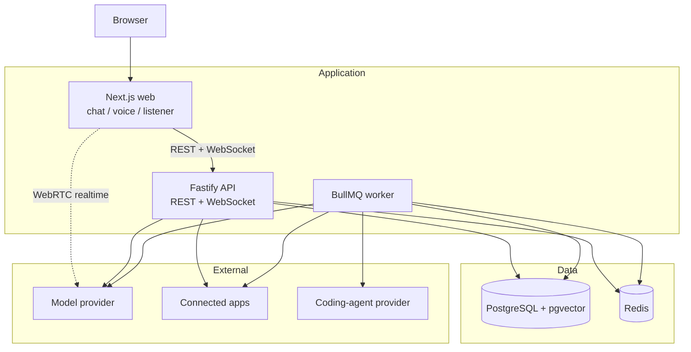
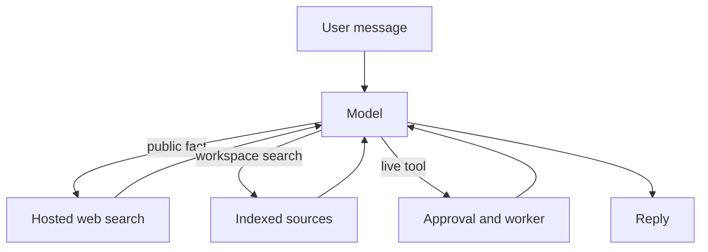

# Agentic AI Assistant

Agentic AI Assistant (AAA) is a personal assistant you run yourself. You can chat with it or talk to it. It remembers you, looks through your notes and connected accounts, and can take actions you approve.

With most AI chats, your conversations, memories, and files live on the company's site. Here, they stay with you. The model only sees what it needs to answer, and when a better model comes along you can switch to it without losing your history.

## Features

- Chat interface with persistent conversation history
- Voice mode with live transcription and spoken responses
- Answers drawn from your notes, files, and connected accounts
- Persistent personalization, preferences, and long-term memory
- Asks for approval before it changes something, such as a document or a repository

### How it answers

When you send a message, the assistant answers. If it needs something the conversation does not already have, it can look it up:

- **The web** — A current public fact
- **Your files** — Notes, attachments, and files from connected accounts
- **Connected apps** — GitHub, Google, and other tools. Changes wait for your approval

A repository task is handed to a coding-agent provider, separate from the chat model. The assistant tells you what happened in the same conversation. You can change that provider without changing the conversation.

### Live Voice

Live voice makes the assistant feel more natural to work with by letting users talk through ideas, ask follow-up questions, and keep a conversational flow without leaving the chat experience.

### Personalization

Personalization settings control both assistant behavior and long-term memory. Communication preferences, such as tone and writing style, and durable memories, such as facts, relationships, and important people, are saved with the assistant and carry from one conversation to the next.

### Connected Apps

Provider apps connect once per external provider and expose separate internal capabilities:

- **Knowledge** — Used for sync, indexing, and retrieval, such as using docs or repository context for RAG
- **Tools** — Used for live tool access and side-effectful operations, such as editing docs in Google Drive or handing a repository task to the coding-agent provider

## Architecture

### System Architecture

The browser talks to the web app. Chat goes through the API. Voice connects onward to the model provider. The API stores conversations, memory, and files in PostgreSQL, and uses Redis to hand off slower work. The worker does that work: syncing connected accounts, preparing search, running tools you approved, and checking on repository tasks.



The model provider answers and handles live voice. Connected apps are the accounts you link, such as GitHub and Google. Repository work goes to its own coding-agent provider, which you can change without changing the conversation. The worker starts the task and brings the summary back. In production, the web app, API, worker, and databases run on one host behind a reverse proxy. See the infrastructure docs for deploy details.

### From Message to Reply

You send a message, and the model answers. If the conversation does not already have what it needs, the model can check a public fact, search your files, or use a connected app. A change to a document or a repository waits for your approval, then runs in the background. When it finishes, the model tells you what happened.



## Local Development Setup

### Prerequisites

- **Node.js** >= 20
- **pnpm** >= 9
- **Docker** and **Docker Compose** (for local services)
- **Model provider API key**
- **WSL or Git Bash on Windows** recommended for local app startup

### Clone The Repository

```bash
git clone https://github.com/your-org/agentic-ai-assistant.git
cd agentic-ai-assistant
```

### Configure The Environment

```bash
cp .env.example .env
# Edit .env and add your real values
```

See `.env.example` for the full template.

### Install Dependencies

```bash
pnpm install
```

### Start The App

```bash
pnpm dev:local
```

That command handles the local startup flow for you.

### Verify It’s Working

- Open `http://localhost:3000`
- Check API health at `http://localhost:3001/health`
- Use development login from the home page when `NODE_ENV` is not `production`

### Local Observability

`pnpm dev:local` also starts the local observability stack with Grafana, Prometheus, Loki, and Tempo. App, API, worker, metrics, and dashboard endpoints are exposed locally for debugging and development.

## License

This project is licensed under the [GNU General Public License v3.0](LICENSE).
